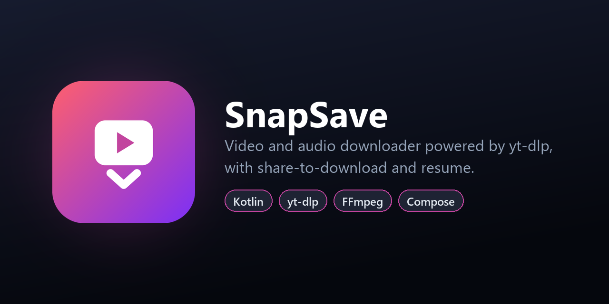

<p align="center">
  
</p>

<p align="center">
  <a href="https://github.com/souvik-das-tech/SnapSave/releases/latest"></a>
  
  
  
  
  
</p>

# SnapSave

A clean, fast video and audio downloader for Android, built on
[yt-dlp](https://github.com/yt-dlp/yt-dlp) and FFmpeg. Share a link from any app, pick a
quality from the formats the video actually has, and the download runs in the background.
It can pause and resume.

## Download

Get the latest APK from **[Releases](https://github.com/souvik-das-tech/SnapSave/releases/latest)**
(Android 8.0 or newer).

## Features

- **Share to download.** Tap *Share → Save with SnapSave* in any app, or paste a link.
- **Real quality list.** The link is probed first, so the picker only offers the resolutions
  and audio formats this video really has, grouped into **Video** and **Audio**. Your last
  choice is pre-selected.
- **Phone-friendly output.** At the same resolution it prefers H.264 + AAC, which every phone
  can play. Audio can be saved as **MP3**, as **M4A**, or as the original track without
  conversion.
- **Download queue.** Several downloads run in parallel (configurable), and the rest wait in a
  queue.
- **Pause and resume.** Pausing keeps the partial files, so the download continues where it
  stopped instead of starting over.
- **Reliable in the background.** A foreground service with a progress notification keeps the
  CPU and Wi-Fi awake. There is a one-time prompt to turn off the aggressive battery
  optimisation found on Realme, Oppo, Vivo and Xiaomi phones.
- **Engine updates.** The app checks GitHub for a newer yt-dlp release and updates it in place,
  so it keeps working as websites change.
- **Saved to Downloads/SnapSave**, with a notification for each finished download. Tap it to
  play the file.
- **Light and dark themes**, with thumbnails loaded by Coil.

## Architecture

```
app/src/main/java/com/bbcl/snapsave/
├── MainActivity.kt          Entry point, permissions, battery-optimisation prompt
├── ShareActivity.kt         "Share → SnapSave" target, forwards the link
├── SnapSaveApp.kt           Application: engine initialisation
├── download/
│   ├── Downloads.kt         Queue, workers, pause/resume, MediaStore export, yt-dlp updates
│   ├── DownloadService.kt   Foreground service, wake/Wi-Fi locks, notifications
│   ├── DownloadItem.kt      Download state model and persistence
│   └── Formats.kt           Probing a link (yt-dlp -J) and building format selectors
└── ui/
    ├── HomeScreen.kt        Link card, download list, settings
    ├── ShareSheet.kt        Video/Audio quality picker
    ├── Icons.kt, Theme.kt   Icons and Material 3 theme
```

Each download runs the bundled yt-dlp on its own worker thread. Probed link info is cached
for a short time, so the download doesn't extract the page a second time.

## Tech stack

- **Kotlin 2.4**, **Jetpack Compose** (Material 3), Coroutines and Flow
- [youtubedl-android](https://github.com/JunkFood02/youtubedl-android) (yt-dlp + FFmpeg packaged for Android)
- [Coil 3](https://coil-kt.github.io/coil/) for thumbnails
- Min SDK 26 (Android 8.0), target SDK 36

## Permissions

| Permission | Why |
| --- | --- |
| `INTERNET` | Downloading |
| `FOREGROUND_SERVICE`, `FOREGROUND_SERVICE_DATA_SYNC`, `WAKE_LOCK` | Keep downloads running with the screen off |
| `POST_NOTIFICATIONS` | Progress and completion notifications |
| `REQUEST_IGNORE_BATTERY_OPTIMIZATIONS` | Optional prompt to stop the system from pausing downloads |
| `WRITE_EXTERNAL_STORAGE` (Android 9 and lower) | Saving to the Downloads folder |

## Build from source

Requirements: Android Studio (or the Android SDK with platform 36) and JDK 17+.

```bash
git clone https://github.com/souvik-das-tech/SnapSave.git
cd SnapSave
./gradlew assembleRelease     # app/build/outputs/apk/release/
```

The release build is signed with the debug key so it installs out of the box. Add your own
`signingConfig` before publishing to a store.

## Disclaimer

SnapSave is a personal project for learning and for downloading content you have the right to
save. Respect copyright and the terms of service of the websites you use. The author is not
responsible for misuse.

## License

Released under the [MIT License](LICENSE). yt-dlp is released under the Unlicense, and FFmpeg
under the LGPL/GPL.

## Author

**Souvik Das** · [GitHub @souvik-das-tech](https://github.com/souvik-das-tech)

If you find this project useful, please consider giving it a ⭐.
